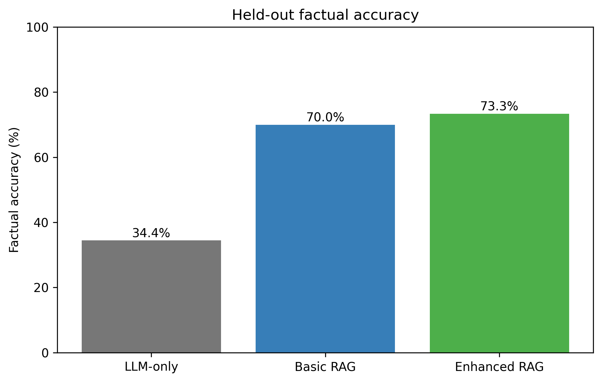
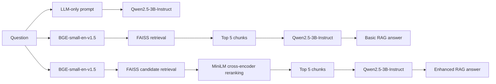
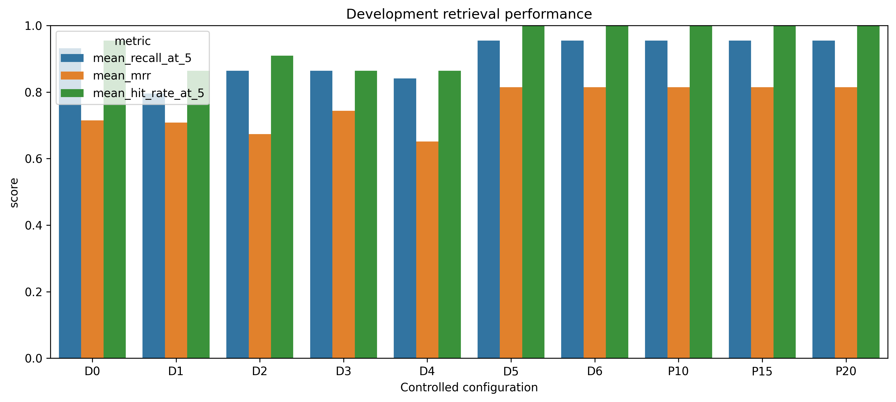
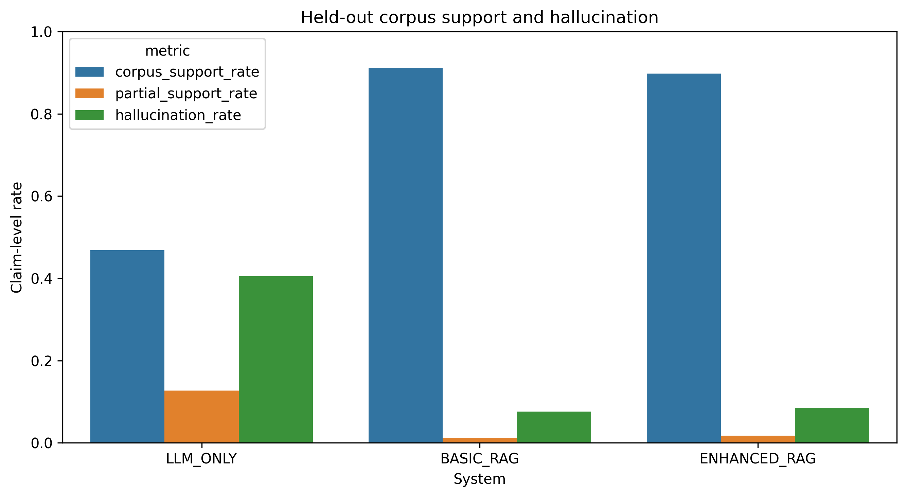
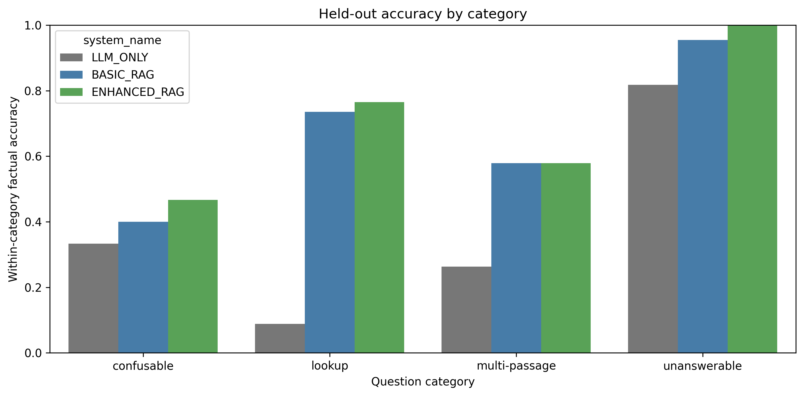

# Controlled RAG Evaluation for University Policy Documents

A controlled Retrieval-Augmented Generation (RAG) study comparing an **LLM-only baseline**, **Basic RAG**, and **Enhanced RAG with cross-encoder reranking** on a fixed collection of public university-policy documents.

The focus is not on building another chatbot. It is on **measuring when retrieval improves factual reliability, when stronger retrieval does not translate into better answers, and how retrieval failures can be separated from generation and citation failures**.

> **Research prototype only.** This repository is not an official source of University of East London policy advice.

## Headline results

| Metric | LLM-only | Basic RAG | Enhanced RAG |
|---|---:|---:|---:|
| Factual accuracy | **34.4%** | **70.0%** | **73.3%** |
| Mean completeness (0–2) | 0.556 | **1.189** | **1.222** |
| Corpus-supported claims | 46.8% | **91.1%** | 89.8% |
| Hallucinated claims | 40.5% | **7.6%** | 8.5% |
| Correct refusal | 81.8% | 95.5% | **100%** |
| Median latency | 4.07 s | 7.46 s | 7.74 s |

Basic RAG more than doubled factual accuracy while sharply reducing unsupported claims.



The main statistical conclusion is deliberately restrained: the LLM-only → Basic RAG gains in factual accuracy and completeness were significant after Holm correction, while the small Basic RAG → Enhanced RAG answer-quality gains were **not** statistically significant.

## Experimental design

The completed study used:

- **15** version-controlled public university documents;
- **120** researcher-verified questions;
- **30 development** questions for retrieval configuration decisions;
- **90 protected held-out** questions for the final system comparison;
- **143 stable evidence units** independent of retrieval chunk boundaries;
- **270 held-out outputs** across three systems, all completed successfully;
- lookup, multi-passage, confusable and unanswerable question categories;
- researcher-only, system-blinded manual scoring with a frozen rubric;
- question-level paired statistics and bootstrap confidence intervals.

The development/held-out separation was fixed before final evaluation to reduce tuning leakage.

## System architecture



### Frozen technical configuration

| Component | Final configuration |
|---|---|
| Generator | `Qwen/Qwen2.5-3B-Instruct` |
| Generator quantisation | 4-bit NF4, double quantisation, float16 compute |
| Embedding model | `BAAI/bge-small-en-v1.5` |
| Vector search | FAISS inner-product search on normalised embeddings |
| Basic RAG | 512-token chunks, 10% overlap, top-k 5, no reranking |
| Enhanced RAG | 512-token chunks, 10% overlap, candidate pool 10, cross-encoder reranking, top-k 5 |
| Reranker | `cross-encoder/ms-marco-MiniLM-L6-v2` |
| Generator decoding | greedy (`do_sample=False`), one beam, max 256 new tokens |
| Final runtime | Google Colab, NVIDIA Tesla T4 |

The exact Hugging Face commit revisions used in the frozen run are recorded in [`config/frozen_protocol_summary.json`](config/frozen_protocol_summary.json).

## RQ2 — controlled retrieval development

Chunk size, overlap and reranking were varied **one factor at a time** on the 30-question development set.



The selected Enhanced configuration retained the 512-token / 10% overlap baseline and added reranking. Candidate pools of 10, 15 and 20 tied on retrieval effectiveness, so pool 10 was selected for lower latency.

This is an **exploratory configuration choice**, not evidence that 512 tokens or 10% overlap are universally optimal.

## Retrieval improved — but stronger retrieval did not guarantee better generation

Enhanced RAG improved retrieval over Basic RAG:

| Retrieval metric | Basic RAG | Enhanced RAG |
|---|---:|---:|
| Hit Rate@5 | 0.897 | **0.956** |
| Recall@5 | 0.831 | **0.912** |
| MRR | 0.697 | **0.750** |

However, final factual accuracy only moved from 70.0% to 73.3%, and the paired difference was not statistically significant.

Manual semantic citation quality also fell:

- citation correctness: **76.8% → 67.3%**
- citation coverage: **74.7% → 62.5%**

This is one of the central findings: **retrieving more of the right evidence does not ensure that the generator will integrate conditions correctly or attach the right citation to each claim.**



## RQ3 — relationship between retrieval and answer quality

For Basic RAG:

- complete evidence retrieval was associated with **5.43× higher estimated odds** of factual accuracy;
- Fisher's exact test: **p = 0.007**;
- MRR vs completeness: **Spearman ρ = 0.319, p = 0.008**.

For Enhanced RAG, neither association was statistically supported.

The interpretation is associative rather than causal: once retrieval became consistently strong, generation, condition handling and citation attachment became more visible bottlenecks.

## Performance by question type



The largest gain came from direct lookup questions. Multi-passage and confusable questions remained harder, which is consistent with the need to combine conditions across passages and distinguish similar policy concepts.

## Repository structure

```text
controlled-rag-university-documents/
├── README.md
├── requirements.txt
├── .gitignore
├── notebooks/
│   ├── results_walkthrough.ipynb
│   └── controlled_rag_full_pipeline.ipynb
├── assets/
│   ├── development-retrieval.png
│   ├── heldout-factual-accuracy.png
│   ├── heldout-claim-support-hallucination.png
│   └── heldout-accuracy-by-category.png
├── data/
│   ├── corpus_manifest.csv
│   ├── questions_metadata.csv
│   ├── evidence_metadata.csv
│   ├── question_distribution.csv
│   └── dataset_summary.csv
├── config/
│   ├── frozen_protocol_summary.json
│   ├── prompts.json
│   ├── scoring_rubric.json
│   ├── analysis_specification.json
│   └── requirements_frozen.txt
└── results/
    ├── development_retrieval_summary.csv
    ├── development_selection.json
    ├── heldout_system_summary.csv
    ├── heldout_category_summary.csv
    ├── heldout_objective_summary.csv
    ├── primary_statistical_tests.csv
    ├── secondary_paired_effects.csv
    ├── rq3_odds_ratios.csv
    ├── rq3_mrr_completeness_spearman.csv
    └── run_completion_record.json
```

## Two notebooks, two purposes

### `results_walkthrough.ipynb`
The quickest way to review the project. It loads the committed result tables and reproduces the main analysis without downloading models or source documents.

### `controlled_rag_full_pipeline.ipynb`
A cleaned copy of the actual final executed implementation pipeline: source validation, deterministic cleaning, stable evidence alignment, chunking, FAISS retrieval, reranking, frozen protocol creation, controlled generation, blinded scoring support and paired statistical analysis.

`controlled_rag_full_pipeline.ipynb` is a cleaned public copy of the **actual final executed dissertation notebook**. Stored Colab outputs and viva/submission-specific notes were removed for readability, and the three Hugging Face model revisions were pinned to the exact immutable commits recorded by the frozen run. The experimental pipeline, safeguards, scoring workflow and analysis logic are otherwise preserved. The committed CSV/JSON files remain the authoritative final result tables. On a fresh public rerun, the notebook now skips the manual-scoring lock stage gracefully when the private completed scoring workbook is absent, rather than treating that absence as a pipeline failure.

## Reproducing the full experiment

The repository deliberately does **not** redistribute the original university policy PDFs/DOCX files or the complete private scoring workbooks.

To reconstruct the corpus:

1. use `data/corpus_manifest.csv`;
2. download the recorded public documents from their source URLs;
3. verify each SHA-256 hash;
4. run `controlled_rag_full_pipeline.ipynb` in a GPU-enabled Colab environment.

The original frozen environment and model revisions are preserved under `config/`.

## Limitations

- one institution and only 15 documents;
- 90 held-out questions, with smaller per-category counts;
- one dense retriever, one reranker and one 3B generator;
- one-factor-at-a-time development testing did not estimate factor interactions;
- researcher-only scoring provides no independent inter-rater reliability estimate;
- AI assisted with draft annotations before the researcher reviewed every final scoring record;
- PDF/DOCX extraction quality can affect evidence alignment;
- latency was measured on one Colab Tesla T4 allocation and is not a production benchmark;
- policies can change after the frozen 2025–26 corpus.

These results therefore support conclusions about the **tested pipeline and corpus**, not RAG systems in general.

## Academic context

This repository is a portfolio adaptation of an **MSc Artificial Intelligence dissertation (CN7000)**. The dissertation's main contribution was the controlled research design, evaluation methodology, statistical analysis and critical interpretation rather than the development of a standalone chatbot.

## Responsible use

The system should be treated as an **evidence-navigation research prototype**, not an authoritative policy adviser. A real deployment would need visible document versions, direct source links, strong refusal behaviour, update monitoring and escalation to official guidance.
